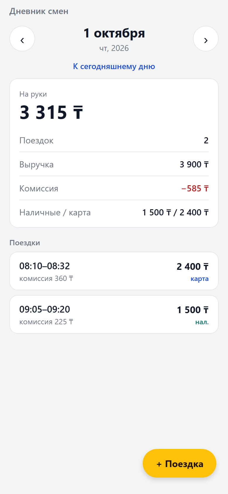
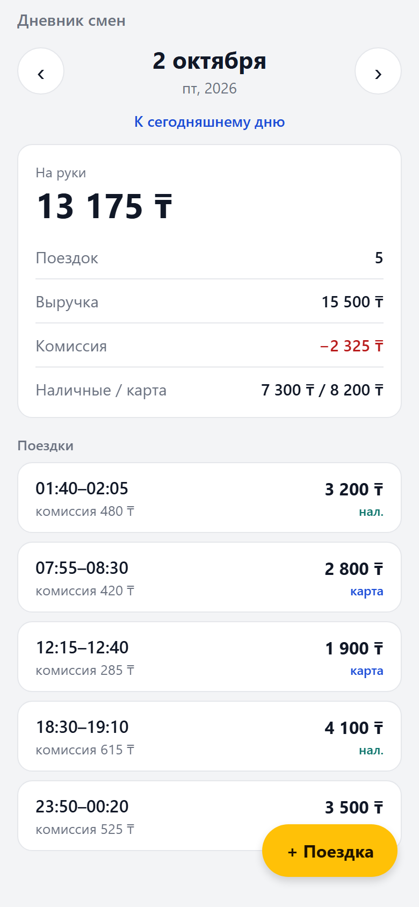
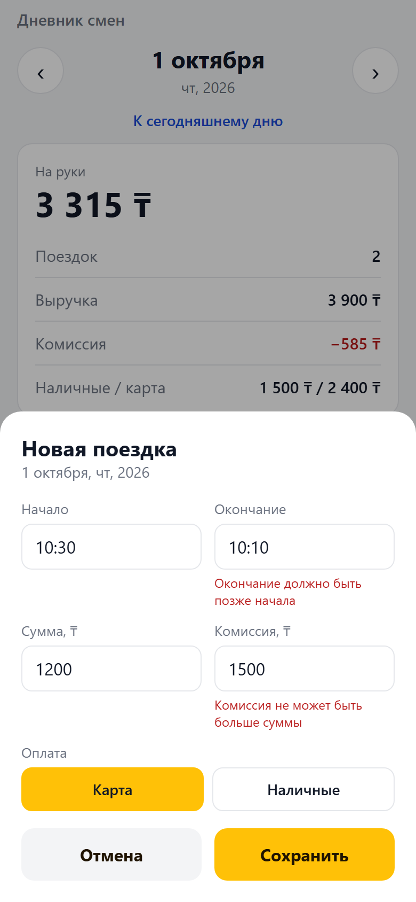
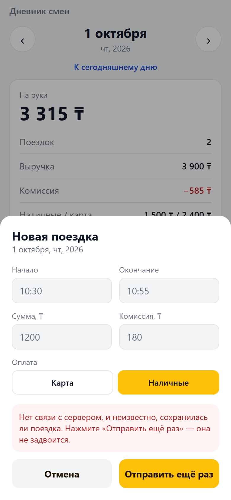

# Дневник смен водителя

Тестовое задание [jobs.arqa.cc](https://jobs.arqa.cc/): сервер отдаёт поездки и сводку за
день, мобильное приложение показывает их, листает дни и добавляет поездки без дублей.

|                       Сводка за день                        |                       Ночные поездки                        |                       Проверка формы                       |                             Обрыв связи                              |
| :---------------------------------------------------------: | :---------------------------------------------------------: | :--------------------------------------------------------: | :------------------------------------------------------------------: |
|  |  |  |  |
|                1 октября = пример из задания                |              01:40 и 23:50–00:20 — в своём дне              |          все ошибки сразу, общая схема с сервером          |                 данные заморожены, повтор без дубля                  |

Ещё скриншоты: [пустой день](docs/screenshots/04-empty-day.png),
[форма](docs/screenshots/02-add-trip.png), [после добавления](docs/screenshots/05-after-add.png).
Их снимает E2E-сценарий [e2e/screenshots.py](e2e/screenshots.py) (Playwright): он проходит
приложение и проверяет через API, что после обрыва связи дубль не создан.

**Стек:** TypeScript · Fastify 5 · SQLite (`node:sqlite`) · Expo SDK 57 / React Native · Zod 4 · Vitest.
**Разработка:** Claude Code с сабагентами: спецификация → тесты от независимого агента →
код → ИИ-ревью в свежем контексте → E2E. Где ИИ ошибся и что исправлено —
[docs/AI_WORKFLOW.md](docs/AI_WORKFLOW.md).

## Запуск

Нужен Node.js **22.13+** (встроенный `node:sqlite`).

```bash
npm install
npm run dev:server     # API на http://localhost:3000, демо-данные из data/trips.json
npm run dev:web        # приложение в браузере (в другом терминале)
```

**На телефоне:** установить Expo Go, выполнить `npm run dev:mobile` и отсканировать QR-код.
Телефон и компьютер должны быть в одной сети; адрес API приложение берёт из адреса
dev-сервера (порт 3000). Другой адрес можно задать через `EXPO_PUBLIC_API_URL`.

Сегодня в демо-данных поездок нет: на пустом дне есть кнопка «Последняя смена», а
**1 октября** совпадает с примером из задания (2 поездки, на руки 3 315 ₸).

```bash
npm test               # 242 теста: core, API, клиентская логика
npm run check          # формат + линт + типы + тесты (то же, что в CI)
```

Настройки сервера (переменные окружения): `PORT` (3000), `DB_PATH` (`data/diary.db`,
`:memory:` — без файла), `DRIVER_TZ` (`Asia/Almaty`), `SEED_FILE` (`data/trips.json`).

## API

| Метод и путь          | Ответ                                                                                                |
| --------------------- | ---------------------------------------------------------------------------------------------------- |
| `GET /api/days/:date` | `200` `{ date, timeZone, utcOffset, summary, trips[] }`; плохая дата → `400`                         |
| `GET /api/days`       | `200` `{ days: [{ date, trips }] }` — дни с поездками, новые сверху                                  |
| `POST /api/trips`     | `201` создана · `200` повтор (дубль не создан) · `409` id занят другими данными · `400` ошибки полей |
| `GET /health`         | `200` `{ ok: true }`                                                                                 |

```bash
curl localhost:3000/api/days/2026-10-01
# "summary":{"trips":2,"revenue":3900,"commission":585,"net":3315,"cash":1500,"card":2400}

curl -X POST localhost:3000/api/trips -H 'content-type: application/json' -d '{
  "id":"a1b2","start":"2026-10-01T10:00:00+05:00","end":"2026-10-01T10:20:00+05:00",
  "amount":1800,"payment":"cash","commission":270}'
# 201 {"created":true,...}; тот же запрос ещё раз → 200 {"created":false,...}
```

## Что сделано и какие решения приняты

Требования переписаны в критерии приёмки [docs/SPEC.md](docs/SPEC.md) (AC-1…AC-10). Id
критерия стоит в названии теста, поэтому покрытие ищется через `grep -rn "AC-6"`.

- **Деньги — целые тенге** ([ADR-0001](docs/adr/0001-money-as-integers.md)). Float отвергается
  на входе, в БД стоят `CHECK`, линтер запрещает `parseFloat`.
- **День считается по часовому поясу водителя, а не по UTC**
  ([ADR-0002](docs/adr/0002-day-boundary.md)). Поездка в 01:40 по Алматы — это по UTC ещё
  предыдущий день; наивный `toISOString().slice(0, 10)` отнёс бы её не туда. Поездка через
  полночь относится к дню начала.
- **Защита от дублей — идемпотентность по `id`** ([ADR-0003](docs/adr/0003-idempotency.md)).
  `id` генерирует клиент один раз на форму и повторяет его при ретраях. Уникальность держит
  `PRIMARY KEY` + `ON CONFLICT DO NOTHING`, а не «проверить, потом вставить», поэтому 20
  параллельных одинаковых запросов дают одну запись. Тот же id с другими данными → `409`,
  а не тихая перезапись. Работает и после перезапуска сервера.
- **Одна схема валидации на сервере и в приложении** (`packages/core`), поэтому ошибки
  в форме и в API совпадают.
- **Клиент** повторяет только сетевые ошибки, таймауты и `5xx`. Если исход сохранения
  неизвестен, форма замораживает отправленные данные: правка суммы под тем же id дала бы
  409, а новая форма — дубль. Ответ `200` без нашей поездки (страница входа в Wi-Fi)
  успехом не считается. При быстром листании дней устаревшие запросы отменяются.

```
packages/core   доменная логика без I/O (общая для сервера и клиента) + тесты
apps/server     Fastify + node:sqlite + тесты API через inject
apps/mobile     Expo-приложение; логика в src/lib покрыта тестами
docs/           SPEC, ADR, AI_WORKFLOW, скриншоты
e2e/            сценарий Playwright, который снимает скриншоты
.claude/        сабагенты, скилл /verify, хук форматирования
AGENTS.md       правила для ИИ-агентов (Codex и Claude Code), CLAUDE.md подключает его
```

## CI

[`.github/workflows/ci.yml`](.github/workflows/ci.yml) запускает формат, линт, типы и тесты,
затем **смоук живого сервера** (поднимает API и сверяет сводку с примером из задания) и
сборку приложения (`expo export --platform web`).
[`ai-review.yml`](.github/workflows/ai-review.yml) запускает того же сабагента-ревьюера на
каждый PR через Claude Code Action. Он включается переменной `AI_REVIEW_ENABLED`.

## Вне рамок

Авторизация и несколько водителей, редактирование и удаление поездок, офлайн-очередь,
поездки через полночь в форме приложения (API их принимает). Следующий шаг для
продакшена — EAS Build и деплой API.
